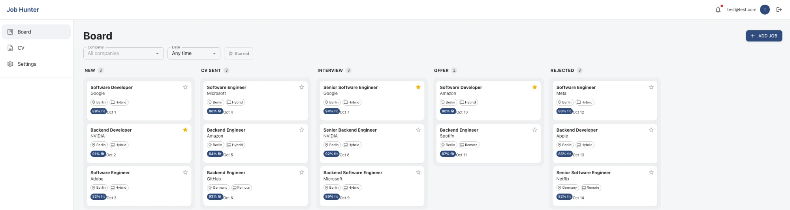
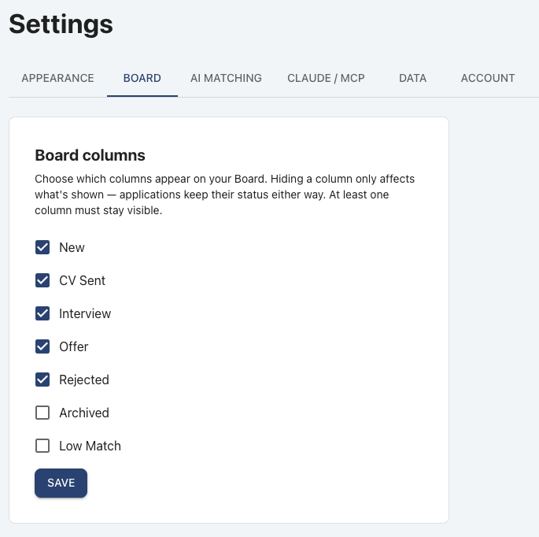
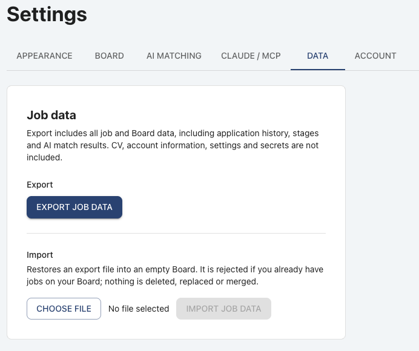

# Job Hunter

Job Hunter is a self-hosted tracker for a job search. It keeps every position you are pursuing on a Kanban Board, stores interview stages and notes per application, holds your CV, and can ask an AI model (Anthropic Claude or Google Gemini, with your own API key) how well a job fits that CV. A small MCP server lets Claude Desktop add jobs to the Board from a conversation.

It was built to replace a spreadsheet: one place for the status of each application, what happened in each interview round, and a quick, explainable fit estimate before investing time in an application.

## Preview



*The Board with demo data: drag tickets between columns, star them, and see each job's fit score at a glance. More screenshots are under [Features](#features).*

This repository is the **backend**. The project consists of three repositories, normally cloned side by side:

| Repository | What it is |
|---|---|
| `job-hunter-server` (this one) | Java / Spring Boot REST API, PostgreSQL schema, AI provider integration |
| `job-hunter-web` | React / TypeScript single-page UI |
| `job-hunter-mcp` | Local stdio MCP server for Claude Desktop (`add_job` and read-only `get_companies` tools) |

```
Docker (docker compose up --build)
 Browser ──► web (nginx, :3000) ──/api/──► backend (Spring Boot, :8080) ──► postgres (internal only)
              static React UI  session cookie + CSRF, same origin          └──► Anthropic / Gemini APIs

Claude Desktop ── job-hunter-mcp (stdio, on the host) ── bearer token ──► http://localhost:8080 (backend)
```

## Quick Start with Docker

This is the recommended way to run Job Hunter. You need **only Git and [Docker Desktop](https://www.docker.com/products/docker-desktop/)** (running). You do **not** need Java, Maven, Node.js, npm or PostgreSQL: they exist only inside the Docker images.

**1. Clone the three repositories into the same parent folder** (any folder; only the sibling layout matters):

```bash
git clone https://github.com/erezalk/job-hunter-server.git
git clone https://github.com/erezalk/job-hunter-web.git
git clone https://github.com/erezalk/job-hunter-mcp.git
```

```
some-folder/
├── job-hunter-server/   <- you run Docker from here
├── job-hunter-web/      <- built by the compose file via ../job-hunter-web
└── job-hunter-mcp/      <- only for the optional Claude Desktop integration
```

**2. Configure (optional but recommended)**

```bash
cd job-hunter-server
cp .env.example .env
```

Nothing in `.env` is required to start Job Hunter as a job tracker. If you want the AI fit evaluation (your own Anthropic/Gemini API key), set `APP_ENCRYPTION_SECRET` in `.env` first. It encrypts the saved API keys, so use a long random value and keep it stable:

```bash
openssl rand -base64 48     # macOS / Linux; paste the output after APP_ENCRYPTION_SECRET=
```

On Windows PowerShell: `[Convert]::ToBase64String((1..48 | ForEach-Object { Get-Random -Maximum 256 }))`. Never commit `.env`.

**3. Start**

```bash
docker compose up --build
```

The first build downloads dependencies and takes a few minutes; later starts take seconds. When the log shows the backend is up, open **http://localhost:3000** and create your account with **Sign up**.

| What | Address (this machine only) |
|---|---|
| Job Hunter in your browser | http://localhost:3000 |
| Backend API (used by the Claude Desktop extension) | http://localhost:8080 |
| PostgreSQL | not published; reachable only by the backend inside Docker |

Both ports are bound to `127.0.0.1`, so they are not reachable from other computers. If a port is taken (for example by a manually started dev server), set `WEB_HOST_PORT` and/or `API_HOST_PORT` in `.env`; if you change `API_HOST_PORT`, use that port in the Claude extension too.

**Everyday commands** (run in `job-hunter-server`)

| Task | Command |
|---|---|
| Run in the background | `docker compose up -d --build` |
| Stop (keeps all data) | `docker compose down` |
| Start again | `docker compose up -d` |
| Show logs | `docker compose logs -f` (or `docker compose logs -f backend`) |
| Status / health | `docker compose ps` |
| Rebuild after `git pull` or source changes | `docker compose up -d --build` (in each repo: `git pull` first) |

The containers restart automatically after a Docker Desktop restart (`restart: unless-stopped`), unless you stopped them with `docker compose down`.

### Your data and where it lives

Two named Docker volumes hold everything; both survive `docker compose down`, `docker compose up`, rebuilds and restarts:

| Volume | Contents |
|---|---|
| `job-hunter-postgres-data` | the PostgreSQL database: accounts, jobs, stages, settings, encrypted AI keys, MCP token digests |
| `job-hunter-cv-storage` | uploaded CV PDFs (`/data/cv-storage` in the backend container) |

(Docker prefixes the names with the Compose project name, by default the folder name, e.g. `job-hunter-server_job-hunter-postgres-data`; see `docker volume ls`.)

> **Warning:** `docker compose down -v` (or `--volumes`) **deletes both volumes and all your Job Hunter data**. Use it only when you deliberately want an empty installation. A plain `docker compose down` is safe.

The schema is created and upgraded by Flyway when the backend starts, exactly as in manual development; nothing needs to be run by hand. An existing database is upgraded in place, never reset.

**Export / import is separate from the volumes.** The Docker volumes preserve this installation's complete PostgreSQL and CV data. **Settings → Data → Export job data** is the portable, application-level backup of your jobs, Board, history, stages and AI match results only; it does **not** contain your CV file, account or password, settings, AI keys or the MCP token. Use it to move job data between installations or to keep a copy, and keep in mind it is not a backup of the Docker volumes.

### Claude Desktop integration (optional)

Claude Desktop runs on your machine, outside Docker, and talks to the backend at **http://localhost:8080** (the port published above). Prerequisite: Claude Desktop. You do not need Node.js or npm on your computer:

1. With Job Hunter running, open http://localhost:3000, sign in, go to **Settings → Claude / MCP** and click **Generate token** (shown once).
2. Build the extension file using Docker only:
   ```bash
   cd ../job-hunter-mcp
   docker build -f Dockerfile.pack --output type=local,dest=. .
   ```
   This creates `job-hunter-mcp.mcpb` in that folder.
3. Open `job-hunter-mcp.mcpb` with Claude Desktop (double-click or drag it in), enter `http://localhost:8080` and the token, enable the extension and start a new chat.

Details and troubleshooting: [`job-hunter-mcp/SETUP.md`](https://github.com/erezalk/job-hunter-mcp/blob/main/SETUP.md).

### Docker notes

- Services: `postgres` (`postgres:17-alpine`), `backend` (this repo's `Dockerfile`; Java 25, non-root), `web` (`../job-hunter-web/Dockerfile`; React build served by nginx, non-root). The backend starts after PostgreSQL is healthy and the web container after the backend is healthy; nginx also looks the backend up on each request, so it recovers by itself when the backend restarts.
- The browser talks only to the web container; nginx forwards `/api/` to the backend, so the UI and API share one origin and the existing `HttpOnly` `JSESSIONID` session, readable `XSRF-TOKEN` cookie and `X-XSRF-TOKEN` header work unchanged. No security setting is relaxed.
- Settings passed from `.env` into the backend container: `APP_ENCRYPTION_SECRET`, `APP_INITIAL_USER_EMAIL` / `APP_INITIAL_USER_PASSWORD` / `APP_INITIAL_USER_FULL_NAME`, `SESSION_TIMEOUT`, `CV_MAX_FILE_SIZE_BYTES`, plus `DB_PASSWORD` (default `job_hunter`; only effective before the database volume is first created, since the database is not reachable from outside Docker). Database URL, bind address, CORS origin and CV directory are set by the compose file.
- Because every browser request now reaches the backend through the web container, the per-IP login/sign-up rate limits see one shared client address. Per-email and per-user limits are unaffected. This is fine for a local, single-user installation.
- CV records store the absolute path of each file. A database created by a manually started backend therefore contains host paths that the container cannot read; use a fresh Docker installation (or re-upload the CV) rather than pointing the Docker backend at a database created by manual development.
- Images are built locally and nothing is published to a registry. Images contain no secrets; `.env` is excluded from every build context.

## Features

- **Accounts** — sign up with email + password (logged in immediately, starting with an empty Board and default settings); change the password in Settings → Account. Every account's data is private to it.
- **Board** — columns New, CV Sent, Interview, Offer, Rejected, Archived and an optional Low Match column. Drag and drop between and within columns (order is persisted), star tickets, filter by company, date added and starred, choose which columns are visible.
- **Tickets** — job details (editable), status, general notes, interview/recruitment stages with dates, and a header bell listing upcoming scheduled stages.
- **Duplicate detection** — a job is identified by normalized company + title; adding it again returns the existing ticket.
- **CV** — upload a PDF, preview it in the browser; text is extracted server-side (PDFBox) for matching.
- **AI fit evaluation** — per job, on request: a 0–100 fit score with matching skills, gaps and concerns. Provider (Claude or Gemini), model and API key are configured per user in Settings. A configurable minimum score moves low-scoring new jobs to a Low Match column.
- **Job data export / import** — download all of your job and Board data (applications, status history, stages, AI match results) as a versioned JSON file and restore it into an empty Board; CV, account, settings and secrets are not included.
- **Claude Desktop integration** — the MCP server's `add_job` tool adds a job (optionally with a fit evaluation Claude already made) to the Board of the user who owns the integration token.

Not included: automatic job discovery, scraping or automation of LinkedIn or other job sites.

### Configurable Board columns

Settings → Board chooses which columns appear on your Board. Hiding a column only changes what is shown; applications keep their status.



### Job data export / import

Settings → Data exports all job and Board data as a portable JSON file and restores it into an empty Board. CV, account information, settings and secrets are not included.



*All screenshots show demo data.*

## Tech stack

Java 25, Spring Boot 4 (Web MVC, Security, Data JPA / Hibernate 7, Validation), Flyway, PostgreSQL 17, Apache PDFBox, Maven Wrapper; tests with JUnit 5 and Testcontainers. AI providers are called over plain REST with Spring's `RestClient` (no vendor SDK). Frontend and MCP stacks are described in their repositories.

## Manual development (without Docker for the app)

For contributors who want to run the backend and frontend from source. Prerequisites: JDK 25, Docker (for PostgreSQL and for the tests), Node.js 20+ for the frontend. No Maven installation is needed (`./mvnw`). Do not run this together with the Docker stack: both use port 8080.

```bash
# 1. Database only (PostgreSQL 17 on 127.0.0.1:5432, data in a named Docker volume)
cd job-hunter-server
docker compose -f docker-compose.yml -f docker-compose.dev.yml up -d postgres

# 2. Optional local configuration (see "Configuration")
cp .env.example .env        # then set APP_ENCRYPTION_SECRET if you want AI features

# 3. API on http://localhost:8080
./mvnw spring-boot:run
```

Tip: put `COMPOSE_FILE=docker-compose.yml:docker-compose.dev.yml` in `.env` to drop the `-f` flags. `docker-compose.dev.yml` only adds the loopback-only `5432` port to the database service.

Then start the frontend (see `job-hunter-web/README.md`) and open http://localhost:5173.

**First login**: create your account through Sign up. No account is created automatically, and no password is ever generated or logged. Optionally, set both `APP_INITIAL_USER_EMAIL` and `APP_INITIAL_USER_PASSWORD` (e.g. in `.env`) to have that account created on a start with an empty database; setting only one stops the app at startup, and both are ignored once any user exists. To start over with an empty database: stop the app and run `docker compose down -v` (this deletes all data).

The API and PostgreSQL listen on `127.0.0.1` only by default.

## Configuration

Settings come from environment variables; a `.env` file in the directory you start the app from (the project root) is read as well. Real environment variables take precedence. See `.env.example`.

| Variable | Default | Purpose |
|---|---|---|
| `APP_ENCRYPTION_SECRET` | *(none)* | Secret used to encrypt AI provider API keys at rest. Required to save a key; the rest of the app works without it. Use a long random value and keep it stable — keys saved under another secret must be re-entered. |
| `APP_INITIAL_USER_EMAIL` / `APP_INITIAL_USER_PASSWORD` / `APP_INITIAL_USER_FULL_NAME` | *(none)* / *(none)* / `Job Hunter` | Optional bootstrap account, created only when email and password are both set and no user exists |
| `DB_URL` / `DB_USERNAME` / `DB_PASSWORD` | `jdbc:postgresql://localhost:5432/job_hunter` / `job_hunter` / `job_hunter` | Database (defaults match `docker-compose.yml`). With Docker, the compose file sets the URL and user; only `DB_PASSWORD` is read from `.env` |
| `WEB_HOST_PORT` / `API_HOST_PORT` | `3000` / `8080` | Docker only: host ports (loopback) for the web UI and the backend API |
| `SERVER_ADDRESS` / `SERVER_PORT` | `127.0.0.1` / `8080` | API bind address and port |
| `CORS_ALLOWED_ORIGINS` | `http://localhost:5173` | Comma-separated origins allowed to call the API with credentials |
| `app.auth.rate-limit.*` (application.yml) | login 30/5 min per IP and 10/15 min per email, sign-up 10/h per IP, password change 5/15 min per user | Authentication rate limits (token buckets) |
| `CV_STORAGE_DIR` | `./data/cv-storage` | Where uploaded CV PDFs are stored (Docker: `/data/cv-storage`, a named volume) |
| `CV_MAX_FILE_SIZE_BYTES` | `10485760` | Maximum CV upload size |
| `AI_CONNECT_TIMEOUT_MS` / `AI_READ_TIMEOUT_MS` | `5000` / `45000` | Timeouts for provider calls |
| `AI_MAX_RETRIES` / `AI_RETRY_INITIAL_BACKOFF_MS` / `AI_RETRY_MAX_WAIT_MS` | `1` / `1000` / `5000` | Retries of transient provider outages (502/503/504/529 only) |

## AI matching

In the UI: Settings → AI Matching. Choose Anthropic or Gemini, a model id, save an API key (from the Anthropic Console or Google AI Studio) and optionally use **Test connection**. Then open a ticket and press **Evaluate fit**.

- The job (title, company, location, work model, description) and the extracted CV text are sent to the provider, which returns structured JSON. A response without a valid integer score from 0 to 100 is rejected; nothing is stored.
- Results are stored per job and user. A non-forced evaluation whose CV, job content, provider and model are unchanged reuses the stored result; **Re-evaluate** always calls the provider.
- **Minimum fit score** (default 70): after an evaluation, a job in New scoring below it moves to Low Match and its description and match details are discarded; a Low Match job scoring at or above it returns to New. Other statuses are never changed.
- API keys are encrypted (AES-256-GCM) and never returned by the API. Provider errors are mapped to safe messages (invalid key, rate limit, quota, unavailable, timeout); transient outages are retried once, rate limits never.
- The provider call runs outside any database transaction; if the CV, model or job changed while it was running, the result is discarded.

## Job data export / import

Settings → Data. **Export job data** downloads `job-hunter-export-YYYY-MM-DD.json` with every job you track and everything about it: job fields, Board status and order, star, notes, full status history, interview stages and the AI match (including External AI matches). It is a logical, versioned format (`formatVersion: 1`) without database ids or owner, meant to survive schema changes. CV, account information, settings (including AI configuration) and secrets are never included.

**Import job data** restores such a file into an **empty** Board: the file is validated completely first, original timestamps and history are kept, and either everything is imported or nothing (single transaction). It is rejected — without changing anything — when you already have jobs on your Board. Other users' data never matters: everything is restored as your own records, even if someone else tracks the same company + title. Restored AI matches are shown as they were but re-run with the current CV on the next evaluation.

## Claude Desktop (MCP)

In Settings → Claude / MCP, generate a personal integration token (shown once; only its hash is stored; one per user; revoke or replace at any time). Build the `job-hunter-mcp` extension (with Docker, see the Quick Start above, or `npm run pack` for contributors), install it in Claude Desktop and enter the backend URL (`http://localhost:8080`, also with the Docker stack) and the token. Claude can then call `add_job` and `get_companies` (read-only: the names of the companies already in the token owner's account, so Claude can skip them during job discovery); jobs land in New on the token owner's Board, with source "External AI". If Claude passes its own fit evaluation, it is stored as an "External AI" match without calling Gemini/Claude through Job Hunter and without applying the Low Match rule; **Re-evaluate** later replaces it with the configured provider's result. Details: `job-hunter-mcp/README.md`.

## Security

- Browser: session cookie (`HttpOnly`) plus CSRF token (`XSRF-TOKEN` cookie / `X-XSRF-TOKEN` header); CORS limited to the configured frontend origin.
- Accounts: passwords are hashed with BCrypt and never returned or logged. Policy: at least 8 characters, at most 72 bytes (BCrypt's limit), no composition rules. Emails are unique ignoring case. Changing the password ends the user's other sessions. Login, sign-up and password changes are rate limited (in memory, per instance — see PROJECT_STATUS.md).
- MCP: a separate stateless filter chain for `/api/integrations/**` only, accepting a bearer token whose only permissions are adding a job and reading the owner's company names; tokens are random 256-bit values stored as SHA-256 digests.
- Ownership: every job, company, Board ticket, stage, status-history entry, AI match, CV, setting and token belongs to exactly one user and is always resolved for the logged-in user (or the token's user); another user's ids answer 404, exactly like missing ones. Two users adding the same company + title get independent records. The database enforces it too (owner columns and composite foreign keys).
- Errors use one JSON format, keep correct 4xx statuses and never include stack traces, SQL or provider responses.
- CV files are stored under server-generated names and only the caller's active CV is ever served.

## API overview

All endpoints except `POST /api/auth/login`, `POST /api/auth/register` and `GET /api/auth/csrf` require a session (or, for `/api/integrations/**`, a bearer token).

| Area | Endpoints |
|---|---|
| Auth | `GET /api/auth/csrf`, `POST /api/auth/login`, `POST /api/auth/logout`, `GET /api/auth/me`, `POST /api/auth/register` (sign-up, logs in), `POST /api/auth/change-password` |
| Board | `GET /api/board`, `POST /api/board/jobs` (add and track; 201 new, 200 already on the Board) |
| Jobs | `GET`/`PATCH /api/jobs/{id}` (a job is created with its ticket via `POST /api/board/jobs` and deleted with it via `DELETE /api/applications/{id}`) |
| Applications | `GET /api/applications`, `GET`/`DELETE /api/applications/{id}`, `PATCH .../{id}/status`, `.../move`, `.../starred`, `.../notes`, `GET .../{id}/status-history`, `GET /api/application-statuses` |
| Stages | `GET`/`POST /api/applications/{id}/stages`, `PATCH`/`DELETE .../stages/{stageId}`, `GET /api/stages/upcoming` |
| CV | `GET`/`POST /api/cv`, `GET /api/cv/file` |
| AI match | `GET /api/jobs/{jobId}/match`, `POST /api/jobs/{jobId}/match/evaluate?force=` |
| Settings | `GET`/`PUT /api/settings`, `PUT`/`DELETE /api/settings/ai/api-key`, `DELETE /api/settings/ai`, `POST /api/settings/ai/test-connection` |
| MCP token | `GET`/`POST`/`DELETE /api/settings/integrations/mcp-token` |
| Job data | `GET /api/job-data/export`, `POST /api/job-data/import` |
| Integration | `POST /api/integrations/jobs`, `GET /api/integrations/companies` (bearer token) |

## Tests

```bash
./mvnw test      # unit + integration tests (Docker must be running)
./mvnw verify    # full build
```

Integration tests run over real HTTP (login, session cookie, CSRF) against a throwaway PostgreSQL container started by Testcontainers. AI providers are replaced by in-memory fakes under the `test` profile, so no test calls a paid API. A multi-user isolation suite (`isolation/`) checks every resource with two users.

To rehearse restoring a real export into the current schema (disposable container only; the file is only read, the output is aggregate counts):

```bash
./mvnw test -Dtest=RealBackupRehearsalTest -Djobhunter.rehearsal.file=/path/to/job-hunter-export-YYYY-MM-DD.json
```

## Known limitations

- No forgot-password/reset, email verification, account deletion or user administration.
- Job data import only restores into an empty Board (no merge).
- No automatic job discovery; LinkedIn scraping/automation is intentionally out of scope.
- A stored AI evaluation is not flagged as outdated after the CV or model changes (use Re-evaluate).
- Designed for a single instance: sessions, the session registry and the rate-limit counters live in memory (a restart logs everyone out and resets the counters). No pagination, HTTP only. Exposing it beyond localhost needs at least TLS and, behind a proxy, `server.forward-headers-strategy` so rate limits see client IPs.

More internal detail for contributors: [PROJECT_STATUS.md](PROJECT_STATUS.md).
